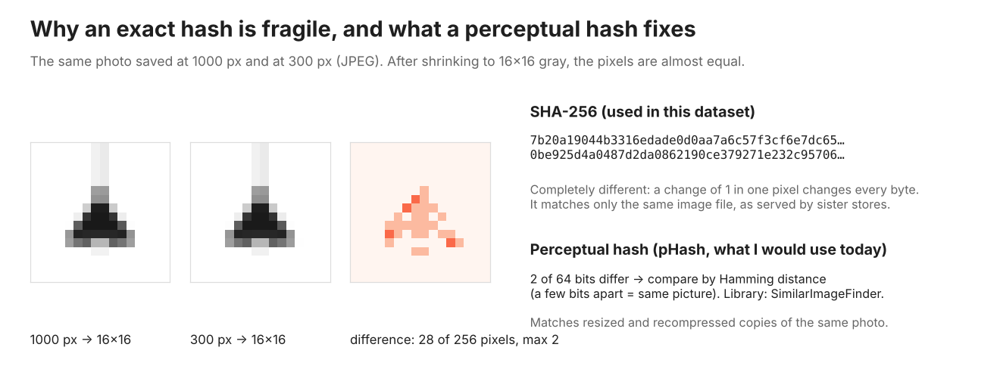
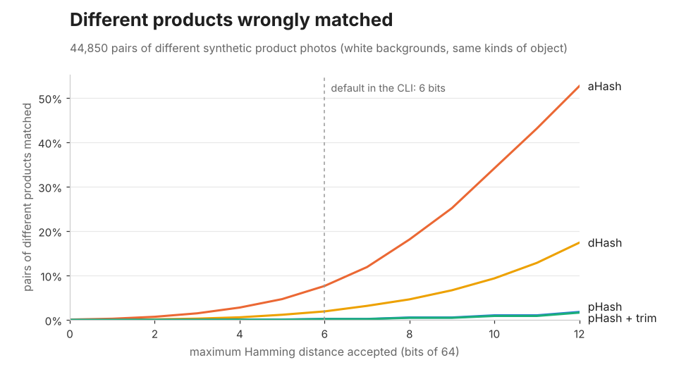

# SimilarImageFinder: perceptual image hashing for Python and .NET

[](https://github.com/CaiqueDourado/SimilarImageFinder/actions/workflows/python.yml)
[](https://github.com/CaiqueDourado/SimilarImageFinder/actions/workflows/dotnet.yml)
[](LICENSE)


[Leia em português](README.pt-BR.md)

**Find duplicate and near-duplicate images, product photos in particular, with perceptual image hashing.** Perceptual hashes (aHash, dHash, pHash), border trimming, an exact search index for millions of hashes and a detector of placeholder images. One algorithm, two implementations: **Python and .NET return the same bits** for the same pixels, checked by shared test vectors.

```python
from similar_image_finder import perceptual_hash, load_gray

a = perceptual_hash("store-a/lamp.jpg")
b = perceptual_hash("store-b/pendente-preto-600x600.webp")
a - b          # Hamming distance: 0-6 = same picture, 20+ = different
```

```csharp
using SimilarImageFinder;

var a = ImageLoader.Hash("store-a/lamp.jpg");                     // pHash, 64 bits
var b = ImageLoader.Hash("store-b/pendente-preto-600x600.webp");
var distance = a - b;
```

```bash
similar-image-finder dupes ./photos -r --max-distance 6 --trim > groups.csv
```

## What perceptual image hashing is

A cryptographic hash (MD5, SHA-256) answers "are these two files identical?": change one pixel and the hash changes completely. A **perceptual hash** answers "do these two images look the same?". It reduces the picture to its coarse structure (a tiny grayscale version, or its lowest frequencies) and writes that structure as a short bit string, usually 64 bits. Two copies of the same photo, resized, recompressed or slightly brightened, get hashes that differ in only a few bits; different photos differ in many. Comparing images then means counting differing bits (the Hamming distance), which is cheap enough to do over millions of images.

| | Cryptographic hash (SHA-256) | Perceptual hash (pHash) |
|---|---|---|
| Same file | equal | equal |
| Same photo, resized or recompressed | completely different | a few bits apart |
| Different photos | completely different | many bits apart |
| Use | integrity, exact duplicates | near-duplicates, reverse image search, catalog matching |

This library implements the three classic perceptual hashes: **aHash** (average), **dHash** (difference, or gradient) and **pHash** (discrete cosine transform), and measures which one to trust on product photos.

## Where it comes from

From 2019 to 2024 I ran a catalog of **114.6 million offers from 7,179 Brazilian online stores** ([catalogo-produtos-ecommerce-brasil](https://github.com/CaiqueDourado/catalogo-produtos-ecommerce-brasil)). Every product photo was downloaded (85.8 million download jobs on 12 to 15 machines), shrunk to 16×16 gray and hashed with SHA-256. The signature was one of the keys that linked the same product across stores, and an image found on more than 100 products was flagged as a placeholder.

It worked for what it could see: sister stores serving the same file, and "no photo" images. Two things it could not do became this library:

1. **It only matched identical files.** SHA-256 changes completely when one pixel changes by 1, so a photo that a store resized or recompressed got a different signature.

   <p align="center"></p>

2. **The signature depended on the machine.** When the images were moved to AWS and hashed again, the values did not match the local ones. The old code hashed the *encoded* 16×16 thumbnail file, whose bytes can change with the encoder version; that is the most likely cause. Here every hash is computed from decoded pixels with integer arithmetic, so it is the same on any machine and in both languages.

## Which hash to use

I measured each method on 300 synthetic product photos, each with 11 edits that stores make (resize, recompress, crop, add a border, watermark…), and on all 44,850 pairs of *different* products. The products are hard to tell apart on purpose: white backgrounds and the same six kinds of object. The benchmark is in [`evaluation/`](evaluation/) and runs in about a minute.

<p align="center"></p>

**aHash and dHash confuse different product photos.** On a white background most of their bits describe the background, so at 6 bits 7.7% (aHash) and 1.9% (dHash) of the pairs of *different* products look like duplicates, and some different products get identical hashes. pHash keeps it at 0.22%.

Share of edited copies found within 6 bits (64-bit hashes):

| Edit | exact SHA-256 | aHash | dHash | pHash | pHash + trim |
|---|---:|---:|---:|---:|---:|
| resize to 50% | 3% | 100% | 100% | 100% | 100% |
| resize to 25% | 0% | 100% | 99% | 100% | 99% |
| JPEG quality 30 | 0% | 100% | 100% | 100% | 99% |
| resize 50% + JPEG 60 | 0% | 100% | 100% | 100% | 86% |
| non-square resize | 11% | 100% | 100% | 100% | 100% |
| brightness +15% | 0% | 100% | 100% | 99% | 98% |
| crop 5% each side | 0% | 93% | 55% | 11% | **96%** |
| white border 10% | 0% | 60% | 9% | 5% | **78%** |
| watermark in a corner | 0% | 95% | 100% | 35% | 0% |
| rotate 3° | 0% | 100% | 60% | 79% | 22% |
| mirror (not a duplicate) | 0% | 23% | 0% | 0% | 0% |
| **different products matched** | 0% | 7.65% | 1.92% | **0.22%** | **0.19%** |

What I take from it:

- **Use pHash** with a distance of 6 to 8 bits. It finds resized, recompressed and brightened copies and rarely confuses different products.
- **Use `trim()` when the margins vary** (the same photo with more or less white around it, or slightly cropped). It hurts with watermarks and rotations, which change the bounding box.
- **The exact signature** is only for identical files. Keep it for compatibility with old data.
- **For product matching, a photo is one signal, not proof.** In the catalog, the image signature was one of 12 keys, next to barcodes and names.

These numbers come from synthetic photos; real photos have textures and shadows. Run the benchmark on your own images before choosing a threshold.

## How pHash works

<p align="center"></p>

The image is shrunk to 32×32 gray with an exact area average. A discrete cosine transform separates coarse shapes from fine detail, and only the 8×8 lowest frequencies are kept. Each one becomes a bit: 1 if it is above their median. Resizing and compression change the details, not the coarse shape, so the bits barely move. Every step uses integers, the DCT included, from a rounded cosine table. The full specification, the one both implementations follow, is in [spec/ALGORITHMS.md](spec/ALGORITHMS.md).

## What is inside

| | Python (`similar_image_finder`) | .NET (`SimilarImageFinder`) |
|---|---|---|
| Load an image (EXIF orientation, transparency on white) | `load_gray(path_or_bytes)` | `ImageLoader.Load(path)` (SkiaSharp) or `GrayImage.FromRgba(...)` |
| Remove a uniform border | `image.trim()` | `image.Trim()` |
| Hashes (any size: 8 = 64 bits, 16 = 256 bits) | `average_hash`, `difference_hash`, `perceptual_hash` | `ImageHasher.AverageHash`, `DifferenceHash`, `PerceptualHash` |
| Exact signature, 2019 format | `exact_signature`, `legacy_decimal` | `ImageHasher.ExactSignature`, `LegacyDecimal` |
| Compare two images directly | `percentage_difference`, `bhattacharyya_distance` | `Similarity.PercentageDifference`, `BhattacharyyaDistance` |
| Search within a distance | `HashIndex(max_distance).query(h)` | `new HashIndex<TKey>(maxDistance).Query(h)` |
| Group near-duplicates | `find_duplicates(items, max_distance)` | `ImageGroups.FindDuplicates(items, maxDistance)` |
| Find placeholders and logos | `find_generic(items, min_owners=100)` | `ImageGroups.FindGeneric(items, minOwners)` |
| Command line | `similar-image-finder hash / dupes` | [`samples/FindDuplicates`](dotnet/samples/FindDuplicates) |

The .NET core has **no dependencies** and works on decoded pixels; `SimilarImageFinder.SkiaSharp` adds file loading.

### Millions of images

Comparing every hash with every other one does not scale. `HashIndex` uses **multi-index hashing**: the 64 bits are cut into four 16-bit bands, and if two hashes are within 6 bits, at least one band is within 1 bit. A query looks up each band and its 16 one-bit variants, then checks only those candidates. The search is exact: nothing within the distance is missed.

With 1,050,000 random 64-bit hashes and a distance of 6, on a 2-core cloud VM:

| | .NET | Python |
|---|---:|---:|
| add all hashes | 5 s | 7 s |
| one query | 0.4 ms | 0.6 ms |
| group everything | 3 min | 9 min |
| pHash of a 1200×1200 image (decoded) | 5 ms | 17 ms |

### Placeholders and logos

```python
from similar_image_finder import find_generic, exact_signature

generic = find_generic(((product_id, exact_signature(path)) for product_id, path in photos), min_owners=100)
```

In the catalog, a signature shared by more than 100 products was almost always a "no photo" image or a store logo. Those images stopped linking products; otherwise, every product without a photo in a store would have been "the same product".

## Same results in Python and .NET

`tools/make_testdata.py` writes [`testdata/golden.json`](testdata/golden.json) from the Python implementation: gray levels, resized grids, the eight EXIF orientations, every hash, trims and comparisons, for 10 PNG images and 8 raw pixel arrays. The .NET tests must reproduce them exactly; CI runs both. JPEG is the only exception: decoders may differ by a gray level in a few pixels, so JPEG hashes may differ by a bit or two between languages.

## Install

Python 3.10+:

```bash
pip install "git+https://github.com/CaiqueDourado/SimilarImageFinder#subdirectory=python"
```

.NET 8:

```bash
git clone https://github.com/CaiqueDourado/SimilarImageFinder.git
dotnet add reference SimilarImageFinder/dotnet/src/SimilarImageFinder.SkiaSharp/SimilarImageFinder.SkiaSharp.csproj
```

On Linux, also add `SkiaSharp.NativeAssets.Linux.NoDependencies`. Releases attach the `.nupkg` and the Python wheel.

## Repository

```
python/        package, tests and CLI
dotnet/        core (no dependencies), SkiaSharp loader, tests, sample
spec/          ALGORITHMS.md: the specification both follow
testdata/      images and golden.json shared by both test suites
evaluation/    the benchmark above (evaluate.py, figures.py, results)
tools/         synthetic product photos and test data generator
```

## Credits

- pHash follows the DCT method described by Christoph Zauner (*Implementation and Benchmarking of Perceptual Image Hash Functions*, 2010) and Neal Krawetz's "Looks Like It" (2011).
- The multi-index search follows Norouzi, Punjani and Fleet, *Fast Search in Hamming Space with Multi-Index Hashing* (CVPR 2012).
- Percentage and Bhattacharyya comparisons were popularised by Jakob Krarup's ImageComparison (xnafan.net, 2012), which the 2019 pipeline used. This is an independent implementation; see [THIRD-PARTY-NOTICES.md](THIRD-PARTY-NOTICES.md).

## License

MIT. By [Caique Dourado](https://github.com/CaiqueDourado).
