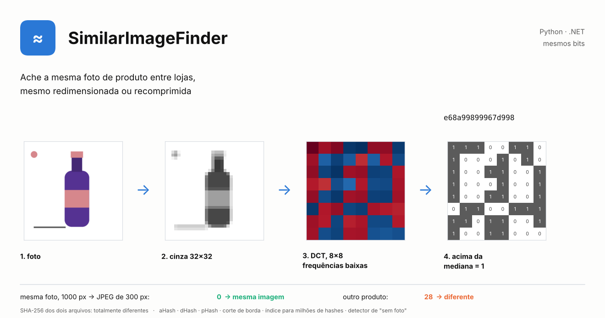
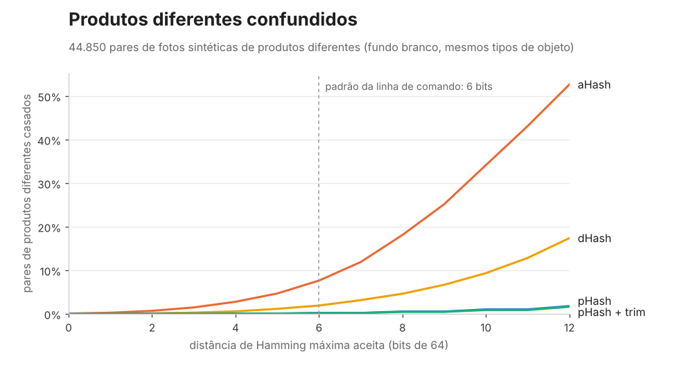
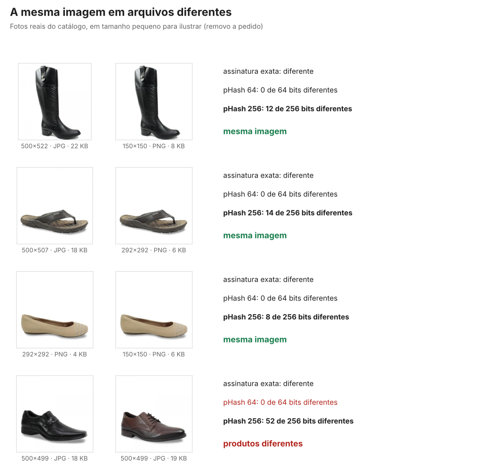
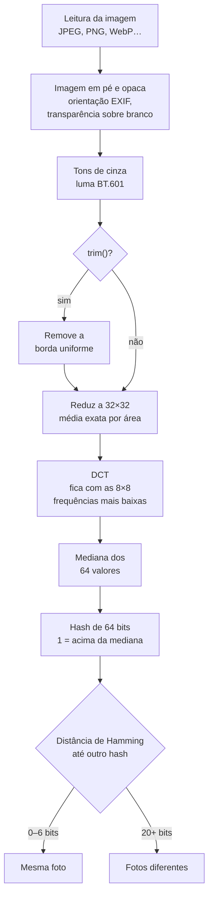

# SimilarImageFinder: hash perceptual de imagens em Python e .NET

[](https://github.com/CaiqueDourado/SimilarImageFinder/actions/workflows/python.yml)
[](https://github.com/CaiqueDourado/SimilarImageFinder/actions/workflows/dotnet.yml)
[](LICENSE)


[Read in English](README.md)



**Encontra imagens duplicadas e quase duplicadas, em especial fotos de produto, com hash perceptual de imagens (perceptual image hashing).** Hashes perceptuais (aHash, dHash, pHash), remoção de borda, um índice de busca exata para milhões de hashes e um detector de imagens genéricas. Um algoritmo, duas implementações: **Python e .NET devolvem os mesmos bits** para os mesmos pixels, conferido por vetores de teste compartilhados.

```python
from similar_image_finder import perceptual_hash

a = perceptual_hash("loja-a/luminaria.jpg")
b = perceptual_hash("loja-b/pendente-preto-600x600.webp")
a - b          # distância de Hamming em 64 bits: 0-6 = mesma foto

perceptual_hash("a.jpg", 16) - perceptual_hash("b.png", 16)   # 256 bits, para fotos de produto: até ~20 = mesma foto
```

```csharp
using SimilarImageFinder;

var a = ImageLoader.Hash("loja-a/luminaria.jpg");                 // pHash, 64 bits
var b = ImageLoader.Hash("loja-b/pendente-preto-600x600.webp");
var distancia = a - b;
```

```bash
similar-image-finder dupes ./fotos -r --size 16 --max-distance 20 > grupos.csv
```

## O que é hash perceptual de imagens

Um hash criptográfico (MD5, SHA-256) responde "esses dois arquivos são idênticos?": mude um pixel e o hash muda por inteiro. Um **hash perceptual** responde "essas duas imagens parecem iguais?". Ele reduz a foto à sua estrutura geral (uma versão minúscula em cinza, ou as frequências mais baixas) e escreve essa estrutura como uma sequência curta de bits, em geral 64. Duas cópias da mesma foto, redimensionadas, recomprimidas ou com brilho alterado, ficam com hashes que diferem em poucos bits; fotos diferentes diferem em muitos. Comparar imagens passa a ser contar bits diferentes (a distância de Hamming), o que é barato o bastante para milhões de imagens.

| | Hash criptográfico (SHA-256) | Hash perceptual (pHash) |
|---|---|---|
| Mesmo arquivo | igual | igual |
| Mesma foto, redimensionada ou recomprimida | totalmente diferente | poucos bits de diferença |
| Fotos diferentes | totalmente diferente | muitos bits de diferença |
| Uso | integridade, cópias exatas | quase duplicadas, busca reversa de imagens, casamento de catálogo |

Esta biblioteca implementa os três hashes perceptuais clássicos: **aHash** (média), **dHash** (diferença, ou gradiente) e **pHash** (transformada discreta do cosseno), e mede em qual confiar com fotos de produto.

## De onde veio

Entre 2019 e 2024 eu mantive um catálogo de **114,6 milhões de ofertas de 7.179 lojas brasileiras** ([GitHub](https://github.com/CaiqueDourado/brazilian-ecommerce-products), dados completos no [Kaggle](https://www.kaggle.com/datasets/caiquedourado/catalogo-produtos-ecommerce-brasil)). Cada foto de produto foi baixada (85,8 milhões de tarefas de download em 12 a 15 máquinas), reduzida a 16×16 em cinza e passada por SHA-256. A assinatura era uma das chaves que ligavam o mesmo produto em lojas diferentes, e uma imagem presente em mais de 100 produtos era marcada como genérica.

Ela funcionava para o que conseguia ver: lojas do mesmo grupo servindo o mesmo arquivo e imagens "sem foto". Duas coisas que ela não fazia viraram esta biblioteca:

1. **Só reconhecia arquivos idênticos.** O SHA-256 muda por inteiro quando um pixel muda em 1, então uma foto que a loja redimensionou ou recomprimiu ganhava outra assinatura.

   <p align="center"></p>

2. **A assinatura dependia da máquina.** Quando as imagens foram para a AWS e o hash foi calculado de novo, os valores não bateram com os locais. O código antigo passava pelo hash o *arquivo codificado* da miniatura 16×16, cujos bytes podem mudar com a versão do codificador; é a causa mais provável. Aqui todo hash sai dos pixels decodificados, com aritmética inteira, e é o mesmo em qualquer máquina e nas duas linguagens.

## Qual hash usar

Medi cada método em 300 fotos sintéticas de produto, cada uma com 11 edições que as lojas fazem (redimensionar, recomprimir, recortar, pôr borda, marca d'água…), e em todos os 44.850 pares de produtos *diferentes*. Os produtos são difíceis de separar de propósito: fundo branco e os mesmos seis tipos de objeto. O teste está em [`evaluation/`](evaluation/) e roda em cerca de um minuto.

<p align="center"></p>

**aHash e dHash confundem fotos de produtos diferentes.** Com fundo branco, a maior parte dos bits descreve o fundo. Com até 6 bits de distância, 7,7% (aHash) e 1,9% (dHash) dos pares de produtos *diferentes* parecem duplicados, e alguns produtos diferentes ficam com o hash idêntico. O pHash fica em 0,22%.

Cópias editadas encontradas com até 6 bits de distância (hashes de 64 bits):

| Edição | SHA-256 exato | aHash | dHash | pHash | pHash + trim |
|---|---:|---:|---:|---:|---:|
| reduzir a 50% | 3% | 100% | 100% | 100% | 100% |
| reduzir a 25% | 0% | 100% | 99% | 100% | 99% |
| JPEG qualidade 30 | 0% | 100% | 100% | 100% | 99% |
| reduzir a 50% + JPEG 60 | 0% | 100% | 100% | 100% | 86% |
| redimensionar sem manter a proporção | 11% | 100% | 100% | 100% | 100% |
| brilho +15% | 0% | 100% | 100% | 99% | 98% |
| recortar 5% de cada lado | 0% | 93% | 55% | 11% | **96%** |
| borda branca de 10% | 0% | 60% | 9% | 5% | **78%** |
| marca d'água no canto | 0% | 95% | 100% | 35% | 0% |
| girar 3° | 0% | 100% | 60% | 79% | 22% |
| espelhar (não é duplicata) | 0% | 23% | 0% | 0% | 0% |
| **produtos diferentes casados** | 0% | 7,65% | 1,92% | **0,22%** | **0,19%** |

### Em fotos reais de produtos

Fotos sintéticas não têm textura nem sombra, então também medi em **442 fotos reais do catálogo de 2019**: 99 grupos de produtos de calçados, sandálias, carteiras e cintos, do jeito que o crawler salvou (de 150 a 724 px, JPEG e PNG). 104 imagens aparecem em mais de um arquivo, o que dá 348 pares de arquivos com a mesma imagem e 97.113 pares que não são. Agrupei os arquivos da mesma imagem conferindo cada grupo a olho ([como](evaluation/real_photos.md)).

As cópias diferem do jeito que as cópias de catálogo diferem: outro tamanho, outro formato, outra margem. A assinatura exata da grade 16×16 acha só **20 dos 348 pares (5,7%)**.

<p align="center"></p>

Todos os métodos acham as cópias. A diferença é quantas imagens **diferentes** cada um também junta:

<p align="center"></p>

Com 64 bits, o pHash guarda só a forma geral do objeto. Dois sapatos diferentes fotografados na mesma pose, no fundo branco, podem ficar com **o mesmo hash de 64 bits**. Com `hash_size=16` (256 bits), o par de cópias mais distante ficou a 14 bits e o par de imagens diferentes mais próximo a 30, então 20 bits separa os dois com folga. As imagens diferentes mais próximas eram variações de cor de um mesmo modelo: a versão marrom e a preta de um sapato, fotografadas do mesmo jeito. Para um catálogo, essa é a resposta certa, porque são produtos diferentes.

O hash de 256 bits também é mais rígido no outro sentido. Nas edições sintéticas, ele continua achando todo redimensionamento, recompressão e mudança de brilho, mas deixa de achar recortes, bordas acrescentadas, marcas d'água e rotações (o `trim()` recupera a maior parte dos recortes e bordas). O `trim()` falhou em fotos reais com fundo cinza de estúdio, que não é uniforme: uma cópia foi recortada e a outra não.

O que eu tiro disso:

- **Para fotos de produto, use pHash com `hash_size=16` e distância de uns 20 bits** (`--size 16 --max-distance 20`). Cópias redimensionadas, recomprimidas ou salvas em outro formato são encontradas, e produtos diferentes, até variações de cor, ficam separados.
- **Use 64 bits (distância de 6 a 8) quando precisar pegar edições**, como recortes, bordas, marcas d'água ou pequenas rotações, e confirme os casamentos com outro sinal, porque produtos diferentes vão casar.
- **Use `trim()` só quando o fundo é liso** (branco ou de uma cor só) e as margens variam.
- **A assinatura exata** só serve para arquivos idênticos. Fica para compatibilidade com dados antigos.
- **Para casar produtos, a foto é um sinal, não uma prova.** No catálogo, a assinatura da imagem era uma das 12 chaves, ao lado de códigos de barras e nomes. O [DedupKit](https://github.com/CaiqueDourado/DedupKit) usa um hash de imagem como uma das regras e recusa pares cujos nomes dizem tamanhos ou cores diferentes.

Os dois testes estão em [`evaluation/`](evaluation/). As fotos reais pertencem às lojas e não estão no repositório; os rótulos e o script estão, para você repetir a medição nas suas fotos.

## Como o pHash funciona

<p align="center"></p>



O catálogo de 2019 usava um caminho mais curto: reduzir a **16×16**, converter para cinza e calcular o **SHA-256** do resultado (`exact_signature`). Sem a DCT e a mediana, ele só reconhece pixels idênticos.

A imagem é reduzida a 32×32 em cinza com média exata por área. Uma transformada discreta do cosseno separa as formas gerais dos detalhes, e só as 8×8 frequências mais baixas ficam. Cada uma vira um bit: 1 se estiver acima da mediana delas. Redimensionar e comprimir mudam os detalhes, não a forma geral, então os bits quase não mudam. Todos os passos usam inteiros, inclusive a DCT, a partir de uma tabela de cossenos arredondada. A especificação completa, a mesma que as duas implementações seguem, está em [spec/ALGORITHMS.md](spec/ALGORITHMS.md).

## O que tem

| | Python (`similar_image_finder`) | .NET (`SimilarImageFinder`) |
|---|---|---|
| Carregar imagem (orientação EXIF, transparência sobre branco) | `load_gray(caminho_ou_bytes)` | `ImageLoader.Load(caminho)` (SkiaSharp) ou `GrayImage.FromRgba(...)` |
| Remover borda uniforme | `imagem.trim()` | `imagem.Trim()` |
| Hashes (qualquer tamanho: 8 = 64 bits, 16 = 256 bits) | `average_hash`, `difference_hash`, `perceptual_hash` | `ImageHasher.AverageHash`, `DifferenceHash`, `PerceptualHash` |
| Assinatura exata, formato de 2019 | `exact_signature`, `legacy_decimal` | `ImageHasher.ExactSignature`, `LegacyDecimal` |
| Comparar duas imagens diretamente | `percentage_difference`, `bhattacharyya_distance` | `Similarity.PercentageDifference`, `BhattacharyyaDistance` |
| Buscar até uma distância | `HashIndex(max_distance).query(h)` | `new HashIndex<TKey>(maxDistance).Query(h)` |
| Agrupar quase duplicadas | `find_duplicates(itens, max_distance)` | `ImageGroups.FindDuplicates(itens, maxDistance)` |
| Achar imagens genéricas e logos | `find_generic(itens, min_owners=100)` | `ImageGroups.FindGeneric(itens, minOwners)` |
| Linha de comando | `similar-image-finder hash / dupes` | [`samples/FindDuplicates`](dotnet/samples/FindDuplicates) |

O núcleo .NET **não tem dependências** e trabalha com pixels decodificados; o `SimilarImageFinder.SkiaSharp` acrescenta a leitura de arquivos.

### Milhões de imagens

Comparar cada hash com todos os outros não escala. O `HashIndex` usa **multi-index hashing**: os 64 bits são cortados em quatro faixas de 16 bits, e se dois hashes estão a até 6 bits, pelo menos uma faixa está a até 1 bit. A busca consulta cada faixa e as suas 16 variações de um bit, e confere só esses candidatos. A busca é exata: nada dentro da distância fica de fora.

Com 1.050.000 hashes aleatórios de 64 bits e distância 6, numa VM de nuvem com 2 núcleos:

| | .NET | Python |
|---|---:|---:|
| inserir todos os hashes | 5 s | 7 s |
| uma busca | 0,4 ms | 0,6 ms |
| agrupar tudo | 3 min | 9 min |
| pHash de uma imagem 1200×1200 (já decodificada) | 5 ms | 17 ms |

### Imagens genéricas e logos

```python
from similar_image_finder import find_generic, exact_signature

genericas = find_generic(((id_produto, exact_signature(caminho)) for id_produto, caminho in fotos), min_owners=100)
```

No catálogo, uma assinatura presente em mais de 100 produtos era quase sempre um "sem foto" ou o logo de uma loja. Essas imagens deixaram de ligar produtos; sem isso, todo produto sem foto de uma loja seria "o mesmo produto".

## Os mesmos resultados em Python e .NET

O `tools/make_testdata.py` gera o [`testdata/golden.json`](testdata/golden.json) a partir da implementação em Python: níveis de cinza, grades reduzidas, as oito orientações EXIF, todos os hashes, recortes e comparações, para 10 imagens PNG e 8 matrizes de pixels. Os testes .NET precisam reproduzir tudo exatamente, e o CI roda os dois. A única exceção é o JPEG: decodificadores diferentes podem divergir em um nível de cinza em alguns pixels, então hashes de JPEG podem diferir em um ou dois bits entre as linguagens.

## Instalação

Python 3.10+:

```bash
pip install "git+https://github.com/CaiqueDourado/SimilarImageFinder#subdirectory=python"
```

.NET 8:

```bash
git clone https://github.com/CaiqueDourado/SimilarImageFinder.git
dotnet add reference SimilarImageFinder/dotnet/src/SimilarImageFinder.SkiaSharp/SimilarImageFinder.SkiaSharp.csproj
```

No Linux, acrescente também o `SkiaSharp.NativeAssets.Linux.NoDependencies`. As releases trazem o `.nupkg` e o wheel do Python.

## Artigo

- [Achando a mesma foto em 7.179 lojas](https://github.com/CaiqueDourado/articles/blob/main/image-similarity/README.pt-BR.md) ([em inglês no Medium](https://medium.com/@caiquedourado/finding-the-same-photo-across-7-179-stores-a4e94bc93777)): a história do catálogo por trás desta biblioteca e as medições.

## Repositório

```
python/        pacote, testes e linha de comando
dotnet/        núcleo (sem dependências), leitor SkiaSharp, testes, exemplo
spec/          ALGORITHMS.md: a especificação que as duas seguem
testdata/      imagens e golden.json usados pelos dois conjuntos de testes
evaluation/    os testes acima: sintético (evaluate.py, figures.py) e fotos reais (real_photos.py, rótulos, resultados)
tools/         fotos sintéticas de produto e gerador dos dados de teste
```

## Créditos

- O pHash segue o método da DCT descrito por Christoph Zauner (*Implementation and Benchmarking of Perceptual Image Hash Functions*, 2010) e por Neal Krawetz em "Looks Like It" (2011).
- A busca segue Norouzi, Punjani e Fleet, *Fast Search in Hamming Space with Multi-Index Hashing* (CVPR 2012).
- As comparações por porcentagem e Bhattacharyya foram popularizadas pelo ImageComparison de Jakob Krarup (xnafan.net, 2012), usado no pipeline de 2019. Esta é uma implementação independente; veja [THIRD-PARTY-NOTICES.md](THIRD-PARTY-NOTICES.md).

## Licença

MIT. Por [Caique Dourado](https://github.com/CaiqueDourado).
